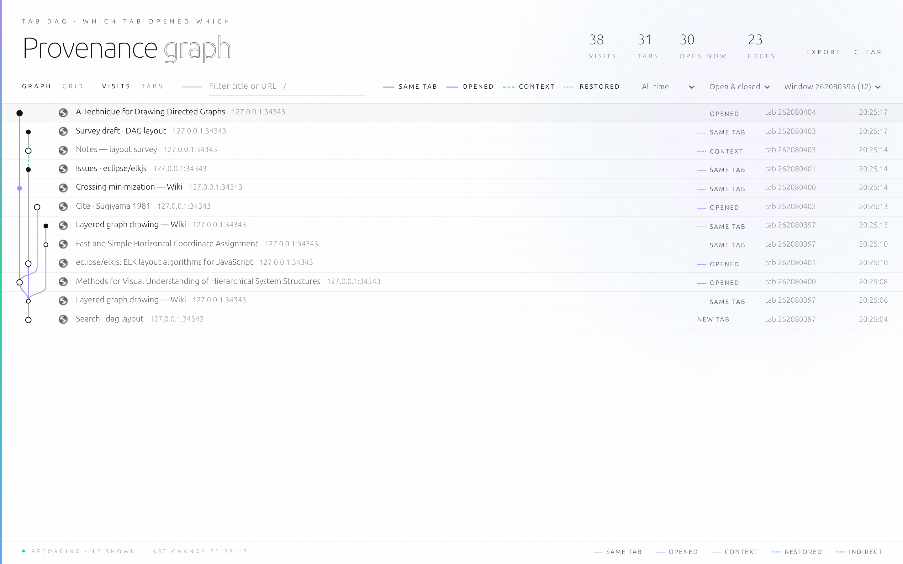
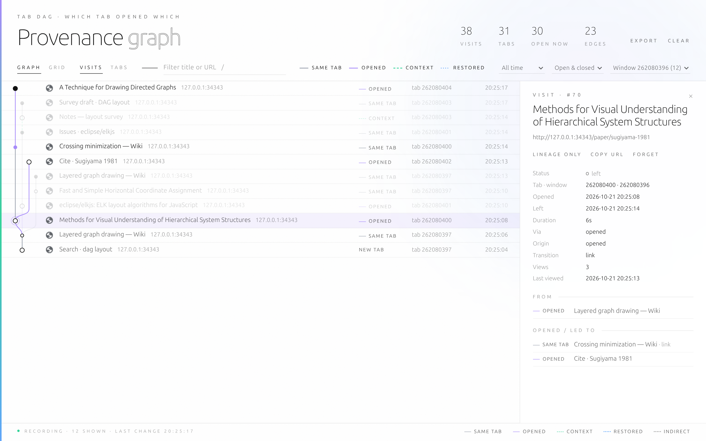
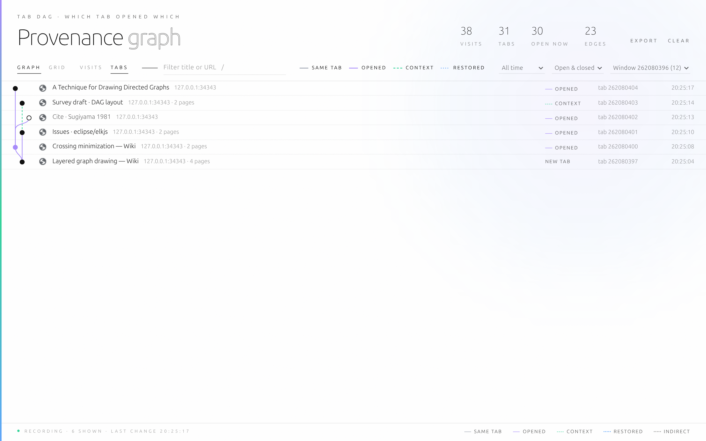
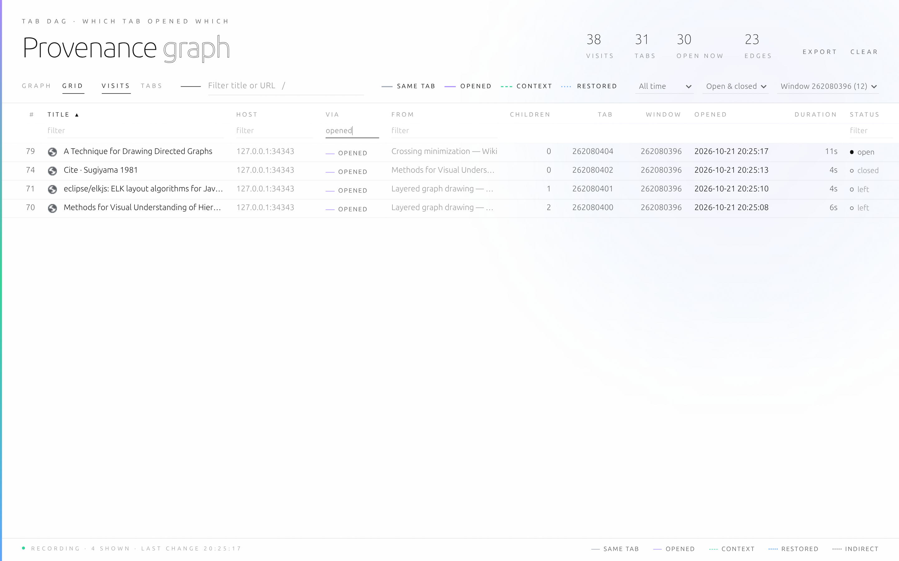
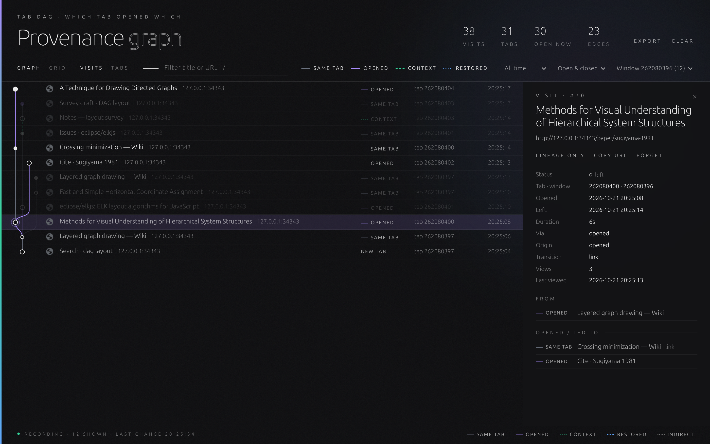

# Tab Dag

Tab provenance for Chrome. Tab Dag records which tab opened which and draws your browsing as a directed acyclic graph (DAG).

Every page view becomes a node, and every "this led to that" becomes an edge. The result is a provenance graph of your browsing, so your history reads as lineage instead of a flat list. Everything is recorded locally in your browser and nothing is sent anywhere.

Keywords. Tab provenance, browsing provenance, provenance graph, DAG, directed acyclic graph, tab tree, tab lineage, navigation graph, browsing history graph, clickstream, research trail, activity tracking, browsing activity log, behavioral insight, cognitive insight, sensemaking, information foraging, attention tracking, personal analytics, local-first, privacy-first.

## What it records

When a page appears in a tab, Tab Dag records it as a visit and links it to where it came from. There are four kinds of link.

| Edge | Meaning |
|---|---|
| Opened | Opened from another page by middle-click, Ctrl+click, a link that opens a new tab, or a page's popup. |
| Same tab | A link followed or a URL typed in the same tab. Back and forward count too. |
| Context | A blank tab (Ctrl+T) that you then took somewhere. It links to the tab you were viewing just before, in the same window. |
| Restored | A tab Chrome reopened after a restart, matched to the tab from the previous session. |

Redirects, reloads and in-page `#section` jumps fold into the visit they belong to. Closed tabs stay in the graph, so their history is kept.

### Why a DAG

A tab has one opener, so "which tab opened which" on its own would be a tree. Tab Dag records more than that. A visit can have two parents, for example the link that opened it and the page you were viewing when you opened it. Each node is one page view. Returning to a page you saw earlier therefore adds a new node and never creates a loop. Every edge points from an older visit to a newer one, which keeps the graph acyclic at all times.

## Views

The graph view draws visits as a DAG with the newest at the top, and gives each edge kind its own color and line style. Select a visit to highlight its lineage, meaning everything it came from and everything it led to. The Lineage only button hides the rest.

The grid view shows the same data as a table with title, host, how each page was reached, its parent, the number of children, tab, window, time opened, duration and status. Click a header to sort, and type in the boxes under the headers to filter each column.

Both views can show one node per page view (Visits) or fold same-tab navigation into one node per tab (Tabs), which gives a tab-level tree. You can search titles and URLs, turn edge kinds on or off, and narrow by time range, open or closed status, or window. When a filter hides pages in the middle of a path, the remaining nodes stay connected with dotted indirect edges.

Selecting a row opens a detail panel with the URL, times, duration, transition type, redirect source, view count, parents and children, plus buttons to go to the tab, copy the URL or forget the visit. Light and dark themes follow your system setting.

| | |
|---|---|
|  |  |
|  |  |

## Who it's for

Researchers and students use it when one review article turns into forty tabs and they need to know which paper led to which. The lineage view answers that for any tab.

Journalists and OSINT investigators can keep a research trail of how they reached each source and export it as JSON. Treat that export as a working record. It is not forensic-grade evidence.

Developers can follow documentation rabbit holes, see which page opened a popup, and check where a login redirect went. The detail panel shows transition types, redirect sources and openers. QA testers can use the same data to reconstruct the navigation path that led to a bug.

UX and behavior researchers can observe how people actually move between pages and tabs, where they branch out, where they return, and which paths they abandon. Use a dedicated browser profile and get the participant's consent.

For knowledge workers curious about their own habits, Tab Dag works as a personal activity record. It shows how far one question branched, how long you stayed on each page, and which tabs you opened and never looked at again. That gives behavioral and cognitive insight into your own information foraging, without an account or a cloud service.

Tab hoarders can switch to the Tabs view to see which tabs came from the same session and close a whole branch at once. And anyone who has wondered how they ended up on a page can find the answer.

## Environments

Tab Dag needs Chrome 116 or later. Other Chromium-based browsers such as Edge and Brave should work but are untested. It runs in an everyday profile, in a dedicated research profile, or in an automated browser driven over the Chrome DevTools Protocol (CDP).

Incognito windows are not recorded unless you allow the extension there. There is no Firefox or Safari version, and recordings do not sync between devices. A link that reuses an already-open named tab is recorded as a same-tab navigation, without the page that triggered it.

## Privacy

All data stays in your browser, in IndexedDB. The extension makes no network requests and has no server. It never reads page content and sees only tab and navigation events, meaning URLs, titles and timestamps.

At install, Chrome warns that the extension can "read your browsing history". That warning is accurate, because recording your browsing path is what the extension does. Forget deletes a single visit, Clear deletes everything, and Export downloads all of it as JSON.

## Install

1. Download `tab-dag-1.0.0.zip` from [Releases](https://github.com/provenance-graph/tab-dag/releases) and unzip it into a folder you will keep.
2. Open `chrome://extensions` and turn on Developer mode.
3. Click Load unpacked and select that folder.

The extension ID (`cffmelgecenkldefhkmhbgaihmmahbcb`) stays the same across reinstalls and updates, so Chrome treats a newer version as the same extension.

## Use

Click the toolbar icon, or press Alt+Shift+P, to open the viewer.

| Key | Action |
|---|---|
| `/` | Search titles and URLs |
| `g` | Graph view |
| `d` | Grid view |
| `j` / `k` | Move the selection down / up |
| `Esc` | Clear the selection |

Double-click a row to switch to that tab if it is still open.

## Export format

Export writes a JSON file with two arrays. Each entry in `visits` is one page view, with `id`, sequence number `n`, `url`, `title`, `tabId`, `windowId`, the opened, left and closed times, the transition type and qualifiers, and any redirect sources. Each entry in `edges` has the form `{ from, to, kind, label }`, where `kind` is `opened`, `context`, `nav` or `restored`, and `from` is always older than `to`.

## License

Tab Dag is free for personal and noncommercial use under the [PolyForm Noncommercial License 1.0.0](LICENSE). Use at a for-profit organization needs a commercial license, available from [Aesthetic Vulpes](https://github.com/didvc).

Copyright 2026 Aesthetic Vulpes. See [NOTICE](NOTICE).

Contributions are welcome. The contribution terms are in the pull request template.
